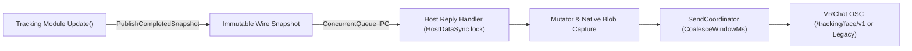

<div align="center">

# VRCFT-Enhance

**Low-latency polling, 1 ms timer leases, and atomic snapshot consistency patches for VRCFaceTracking.**

<p>
  <a href="https://github.com/WolalaQAQ/VRCFT-Enhance/releases"></a>
  
  
  <a href="LICENSE"></a>
</p>

<p>
  <strong>English</strong> · <a href="README_zh.md">简体中文</a>
</p>

<p>
  <a href="#what-it-improves">What It Improves</a> ·
  <a href="#supported-versions">Supported Versions</a> ·
  <a href="#installation">Install</a> ·
  <a href="#tuning-wait-budgets">Tuning</a> ·
  <a href="#how-it-works">How It Works</a> ·
  <a href="#build-and-test">Build</a> ·
  <a href="#community">Community</a>
</p>

</div>

---

## What It Improves

VRCFT-Enhance is an unofficial set of timing and data-consistency patches for [VRCFaceTracking](https://github.com/benaclejames/VRCFaceTracking). It reduces missed tracking updates when the host polls a module's latest state, without changing tracking math or adding a second OSC sender.

- **Faster host sampling (4 ms default)**: Lowers the host polling interval from the official `10 ms` to `4 ms` while leaving each tracking module's own update loop untouched.
- **Process-local 1 ms timer lease**: Requests `1 ms` timer resolution and clears Windows timer-resolution throttling in both the host and module processes. Exit restores only the timer-policy bit it acquired, leaving CPU throttling and process priorities alone.
- **Complete, torn-free snapshots**: Tracking modules publish an immutable byte snapshot only after `Update()` returns, and IPC sends private copies rather than reading live fields mid-write.
- **Synchronized host & teardown path**: Serializes IPC reply application with parameter evaluation and native blob capture, switches the module send queue to `ConcurrentQueue`, and waits for the `Update()` thread before calling `Teardown()`.
- **Clean left outer brow ownership**: Expression modules start writing after `BrowOuterUpLeft` so eye and expression modules do not overwrite each other.

> [!NOTE]
> Because `BrowOuterUpLeft` now belongs exclusively to the eye module, an expression-only setup with no eye module will not update that brow shape.

### Measured Replay Results (Steam VRCFT 6)

In a ~30-second PC replay feeding 2,694 recorded PICO eye/mouth updates (`89.84` sources/s) through a single PICO module, the official sandbox, and a loopback OSC receiver:

| Steam VRCFT 6 | OSC face messages/s | Distinct eye/mouth sources/s at IPC |
|---|---:|---:|
| Unmodified | 94.74 | 78.27 |
| Patched (default `4 ms`) | 212.06 | 88.17 |

The higher OSC packet rate includes repeated snapshots and is distinct from the unique source rate. After 8-bit native OSC quantization (which maps some distinct inputs to identical values), loopback OSC matching confirms `85.94–88.24` distinct sources/s on the patched build.

## Supported Versions

Download the package matching your exact VRCFaceTracking installation. DLLs built for VRCFT 6 and VRCFT 5 are not interchangeable.

| Target | Official Upstream Commit | Release Package Suffix | Source Patch |
|---|---|---|---|
| **Steam VRCFT 6.0.0.0** (Build 26384174) | [`3d363792`](https://github.com/benaclejames/VRCFaceTracking/tree/3d36379253d26961560d84acecd01d509aea467a) | `vrcft6-3d36379.zip` | [`VRCFT-Enhance-3d36379.patch`](VRCFT-Enhance-3d36379.patch) |
| **Legacy VRCFT 5.4.5.0** | [`7add148`](https://github.com/benaclejames/VRCFaceTracking/tree/7add14873e398c4095d06913cdeee7a01fc43fab) | `7add148.zip` | [`VRCFT-Enhance-7add148.patch`](VRCFT-Enhance-7add148.patch) |

> [!WARNING]
> Future Steam VRCFaceTracking updates require a separately verified patch even if the assembly version still displays `6.0.0.0`. Never overwrite a newly updated Steam installation with older patched DLLs.

## Installation

Install into a separate copy so your official Steam installation stays completely untouched.

1. Download the matching `VRCFT-Enhance-<version>-<suffix>.zip` from [Releases](https://github.com/WolalaQAQ/VRCFT-Enhance/releases).
2. Close VRCFaceTracking, then copy your entire **matching, unmodified** VRCFaceTracking folder to a new location (for example, `%LOCALAPPDATA%\Programs\VRCFaceTracking-Patched`).
3. Inspect `provenance.json` inside the ZIP to confirm the target version and upstream commit, then replace **only** these two files in your copy:
   - `VRCFaceTracking.Core.dll`
   - `VRCFaceTracking.ModuleProcess.dll`
4. Launch `VRCFaceTracking.exe` from the copied folder. Keep the SDK, native OSC library, and all other files from the matching official installation.

### Everyday Use & Reverting

- The patched copy shares `%APPDATA%\VRCFaceTracking` modules and settings with the original installation. **Do not run both at the same time.**
- **To switch back to stock**: simply close the copy and launch VRCFaceTracking from Steam.
- **After a Steam update**: make a fresh copy of the new Steam folder and install a patch verified for that commit.

## Tuning Wait Budgets

Both options accept a positive integer in milliseconds, are read once at startup, and default to **`4`**.

| Command-Line Flag | Process Environment Variable | Behavior |
|---|---|---|
| `--osc-poll-ms` | `VRCFT_OSC_POLL_MS` | Interval between host snapshot requests to each tracking module |
| `--osc-output-ms` | `VRCFT_OSC_OUTPUT_MS` | **VRCFT 6**: maximum wait for remaining modules to reply in multi-module setups (*not* a fixed send interval; a single module sends immediately on reply). **VRCFT 5**: periodic output loop wait |

Command-line flags override environment variables. Both `--osc-poll-ms=4` and `--osc-poll-ms 4` syntax work—for example, append to a Windows shortcut's **Target**:

```text
--osc-poll-ms=4 --osc-output-ms=4
```

Shorter polling intervals can catch more unique source updates at higher CPU usage; the patch samples latest state and does not queue or reconstruct missed frames.

---

## How It Works



- **VRCFT 6 architecture preserved**: Keeps upstream's reply-driven `SendCoordinator`, native `/tracking/face/v1` output, pupil encoding, and legacy Avatar routing.
- **Exact patch surface**: Inspect [`VRCFT-Enhance-3d36379.patch`](VRCFT-Enhance-3d36379.patch) (VRCFT 6) and [`VRCFT-Enhance-7add148.patch`](VRCFT-Enhance-7add148.patch) (VRCFT 5), pinned to upstream commits in [`targets.json`](targets.json).

## Build and Test

Requires **Windows**, **PowerShell 7 (`pwsh`)**, **Git**, and the **.NET 10 SDK** (`tar` is included with Windows). From the repository root:

```powershell
git clone https://github.com/benaclejames/VRCFaceTracking.git upstream
pwsh -NoProfile -File tools/build.ps1 -Target vrcft6 -UpstreamSource upstream
# Legacy 5.4.5 target:
pwsh -NoProfile -File tools/build.ps1 -Target vrcft5 -UpstreamSource upstream
```

`tools/build.ps1` exports the exact pinned commit from [`targets.json`](targets.json) into a clean temporary workspace (without modifying `upstream`), applies the matching patch, builds Release x64 DLLs stamped with patch and upstream provenance, runs the snapshot, ownership, timer, native-protocol, and CLI option tests, and writes the ZIP package (`VRCFaceTracking.Core.dll`, `VRCFaceTracking.ModuleProcess.dll`, `INSTALL.txt`, `LICENSE`, `provenance.json`) into a new `artifacts/<target>-<timestamp>/` directory (or `-ArtifactsPath`).

GitHub Actions (`.github/workflows/release.yml`) builds and tests both `vrcft6` and `vrcft5` before publishing tag-matched releases.

## Pico-Enhance Ecosystem

| Project | Purpose |
|---|---|
| [VD-PicoEnhance](https://github.com/WolalaQAQ/VD-PicoEnhance) | Hand tracking, passthrough, bitrate/resolution unlock, and QoL enhancements for Virtual Desktop on PICO |
| [PicoET-Enhance](https://github.com/WolalaQAQ/PicoET-Enhance) | Real pupil diameter, independent per-eye expressions, 90/90 Hz tracking, on-headset tuning & LAN camera streaming for PICO 4 Pro |
| [PicoFacialBridge](https://github.com/WolalaQAQ/PicoFacialBridge) | Headset-to-PC eye and face tracking bridge for PICO |
| [UnifiedPicoModule](https://github.com/WolalaQAQ/UnifiedPicoModule) | VRCFaceTracking module receiving PICO eye and face tracking on PC |
| **VRCFT-Enhance** *(this repo)* | Low-latency polling and snapshot consistency patches for VRCFaceTracking |
| [PicoRegionSwitch](https://github.com/WolalaQAQ/PicoRegionSwitch) | Offline on-headset CN / Global app switcher with isolated dual-region data banks |
| [PicoUSB-Quiet](https://github.com/WolalaQAQ/PicoUSB-Quiet) | Suppresses PICO OS app-switch prompts and USB confirmation flashes on USB re-attach |

## Community

Join the Pico-Enhance community for help, discussion, and release announcements.

<a href="https://discord.gg/ueSEydeVD8"></a>

**QQ group:** 1129699813. Scan the code below with QQ to join.


## License

VRCFaceTracking is copyright **benaclejames** and licensed under the [Apache License 2.0](LICENSE). VRCFT-Enhance uses the same license, and all modified upstream files carry modification notices.
