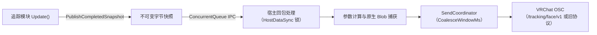

<div align="center">

# VRCFT-Enhance

**面向 VRCFaceTracking 的低延迟轮询、1 ms 定时器租约与完整快照一致性补丁。**

<p>
  <a href="https://github.com/WolalaQAQ/VRCFT-Enhance/releases"></a>
  
  
  <a href="LICENSE"></a>
</p>

<p>
  <a href="README.md">English</a> · <strong>简体中文</strong>
</p>

<p>
  <a href="#主要改进">主要改进</a> ·
  <a href="#支持版本">支持版本</a> ·
  <a href="#安装步骤">安装步骤</a> ·
  <a href="#调整等待时间">参数调节</a> ·
  <a href="#工作原理">工作原理</a> ·
  <a href="#构建与测试">构建与测试</a> ·
  <a href="#社区">社区</a>
</p>

</div>

---

## 主要改进

VRCFT-Enhance 是面向 [VRCFaceTracking](https://github.com/benaclejames/VRCFaceTracking) 的非官方定时与数据一致性补丁，用于减少宿主轮询模块最新状态时遗漏的追踪帧，不改动追踪公式，也不引入第二个 OSC 发送器。

- **更快的宿主轮询（默认 4 ms）**：将宿主采样间隔从官方的 `10 ms` 缩短至 `4 ms`，各追踪模块自身的更新逻辑保持不变。
- **进程内 1 ms 定时器租约**：在宿主进程和模块进程中同时申请 `1 ms` 定时精度，并解除 Windows 对进程定时器精度的忽略策略；退出时只恢复自己持有的策略位，不改动 CPU 节流或进程优先级。
- **完整快照无撕裂传输**：模块在 `Update()` 结束后才打包发布不可变字节快照，IPC 发送独立副本，避免在模块写入中途逐字段读取。
- **宿主同步与安全退出**：对 IPC 回包应用、参数计算及原生 blob 捕获加锁同步；模块发送队列改为线程安全的 `ConcurrentQueue`，退出时先等待 `Update()` 线程结束再调用 `Teardown()`。
- **消除左外眉写入冲突**：表情模块从 `BrowOuterUpLeft` 之后开始写，避免眼部模块与表情模块互相覆盖。

> [!NOTE]
> `BrowOuterUpLeft` 现由眼部模块单独负责。如果只启用表情模块而不开眼部模块，左外眉将不再由表情模块更新。

### 实测表现（Steam VRCFT 6）

在约 30 秒的 PC 回放中，通过单 PICO 模块、官方沙盒和环回 OSC 接收器输入 2,694 个录制好的 PICO 眼嘴更新（`89.84` 个新源/秒）：

| Steam VRCFT 6 | 每秒 OSC 脸部消息 | IPC 中每秒独立眼嘴新源 |
|---|---:|---:|
| 原版 | 94.74 | 78.27 |
| 补丁（默认 `4 ms`） | 212.06 | 88.17 |

较高的 OSC 发包率包含重复快照，不等于唯一追踪源速率。由于原生 8-bit OSC 量化会把部分接近的输入映射到相同值，按环回 OSC 数值归源可确认补丁版每秒输出 `85.94–88.24` 个独立源。

## 支持版本

请下载与你当前 VRCFaceTracking 安装完全匹配的安装包，VRCFT 6 与 VRCFT 5 的两个 DLL 不能混用。

| 目标版本 | 官方源码提交 | 安装包后缀 | 源码补丁 |
|---|---|---|---|
| **Steam VRCFT 6.0.0.0**（Build 26384174） | [`3d363792`](https://github.com/benaclejames/VRCFaceTracking/tree/3d36379253d26961560d84acecd01d509aea467a) | `vrcft6-3d36379.zip` | [`VRCFT-Enhance-3d36379.patch`](VRCFT-Enhance-3d36379.patch) |
| **旧版 VRCFT 5.4.5.0** | [`7add148`](https://github.com/benaclejames/VRCFaceTracking/tree/7add14873e398c4095d06913cdeee7a01fc43fab) | `7add148.zip` | [`VRCFT-Enhance-7add148.patch`](VRCFT-Enhance-7add148.patch) |

> [!WARNING]
> 后续 Steam 推送 VRCFaceTracking 更新后，即使程序集版本仍显示 `6.0.0.0`，也需要等待对应新提交验证后的补丁，切勿把旧补丁 DLL 覆盖到新版目录上。

## 安装步骤

建议安装到独立副本中，保持 Steam 里的官方安装原样不动。

1. 前往 [Releases](https://github.com/WolalaQAQ/VRCFT-Enhance/releases) 下载对应目标的 `VRCFT-Enhance-<版本>-<后缀>.zip`。
2. 关闭 VRCFaceTracking，把完整、**未修改且版本匹配**的 VRCFaceTracking 目录复制到新位置（例如 `%LOCALAPPDATA%\Programs\VRCFaceTracking-Patched`）。
3. 核对压缩包内的 `provenance.json` 确认目标版本与提交号，随后**只替换**副本中的以下两个文件：
   - `VRCFaceTracking.Core.dll`
   - `VRCFaceTracking.ModuleProcess.dll`
4. 运行副本目录中的 `VRCFaceTracking.exe`。SDK、原生 OSC 库及其他依赖保留原版匹配文件。

### 日常使用与回退

- 副本与原版共用 `%APPDATA%\VRCFaceTracking` 中的模块和设置，**不要同时运行两个实例**。
- **切回原版**：关闭副本后，直接从 Steam 启动 VRCFaceTracking 即可。
- **Steam 升级后**：重新复制新版官方目录，并换用明确匹配该提交的补丁。

## 调整等待时间

两个参数均接受正整数（单位毫秒），只在启动时读取，默认值均为 **`4`**。

| 命令行参数 | 进程环境变量 | 作用 |
|---|---|---|
| `--osc-poll-ms` | `VRCFT_OSC_POLL_MS` | 宿主向各追踪模块请求快照的时间间隔 |
| `--osc-output-ms` | `VRCFT_OSC_OUTPUT_MS` | **VRCFT 6**：多模块混搭时等待其余模块回复的最长合并窗口（**不是**固定发送周期；单模块在回复到达后立即发送）。**VRCFT 5**：定时输出循环等待时间 |

命令行参数优先于环境变量，支持 `--osc-poll-ms=4` 和 `--osc-poll-ms 4` 两种写法。例如在桌面快捷方式的「目标」末尾追加：

```text
--osc-poll-ms=4 --osc-output-ms=4
```

缩短轮询间隔有机会捕获更多新源，但会增加 CPU 占用；补丁只做最新状态采样，不为漏掉的源帧排队或补帧。

---

## 工作原理



- **完整保留 VRCFT 6 官方链路**：沿用上游回复驱动的 `SendCoordinator`、原生 `/tracking/face/v1` 输出、瞳孔编码和旧版 Avatar 路由。
- **透明的补丁范围**：完整改动见 [`VRCFT-Enhance-3d36379.patch`](VRCFT-Enhance-3d36379.patch)（VRCFT 6）与 [`VRCFT-Enhance-7add148.patch`](VRCFT-Enhance-7add148.patch)（VRCFT 5），上游提交固定记录在 [`targets.json`](targets.json)。

## 构建与测试

需要 **Windows**、**PowerShell 7（`pwsh`）**、**Git** 和 **.NET 10 SDK**（现代 Windows 已自带 `tar`）。在仓库根目录执行：

```powershell
git clone https://github.com/benaclejames/VRCFaceTracking.git upstream
pwsh -NoProfile -File tools/build.ps1 -Target vrcft6 -UpstreamSource upstream
# 如需构建旧版 5.4.5 目标：
pwsh -NoProfile -File tools/build.ps1 -Target vrcft5 -UpstreamSource upstream
```

`tools/build.ps1` 会从 [`targets.json`](targets.json) 读取固定提交并导出到独立工作目录（不修改 `upstream`），应用对应补丁，构建写入版本来源信息的 Release x64 DLL，运行快照、所有权、定时器、原生协议及命令行参数测试，最后将配套 DLL、`INSTALL.txt`、`LICENSE` 和 `provenance.json` 打包到新的 `artifacts/<目标>-<时间戳>/` 目录（可用 `-ArtifactsPath` 指定）。

GitHub Actions（`.github/workflows/release.yml`）会在发版前自动构建并测试 `vrcft6` 与 `vrcft5` 两个目标。

## Pico-Enhance 生态

| 项目 | 作用 |
|---|---|
| [VD-PicoEnhance](https://github.com/WolalaQAQ/VD-PicoEnhance) | PICO 端 Virtual Desktop 手追、透视、码率与分辨率解锁及多项体验增强 |
| [PicoET-Enhance](https://github.com/WolalaQAQ/PicoET-Enhance) | PICO 4 Pro 真实瞳孔、左右眼独立表情、90/90 Hz 追踪、头显端后处理调节与局域网相机广播 |
| [PicoFacialBridge](https://github.com/WolalaQAQ/PicoFacialBridge) | PICO 头显到 PC 的眼动与面部追踪数据桥接 |
| [UnifiedPicoModule](https://github.com/WolalaQAQ/UnifiedPicoModule) | PC 端接收 PICO 眼追与面捕数据的 VRCFaceTracking 模块 |
| **VRCFT-Enhance**（本仓库） | VRCFaceTracking 低延迟轮询与完整快照一致性补丁 |
| [PicoRegionSwitch](https://github.com/WolalaQAQ/PicoRegionSwitch) | PICO 头显离线国区 / 全球区应用切换与双区数据隔离 |
| [PicoUSB-Quiet](https://github.com/WolalaQAQ/PicoUSB-Quiet) | 消除 PICO 扩展坞 USB 重连时的退出应用弹窗与确认框闪烁 |

## 社区

使用求助、交流和版本更新通知，欢迎加入 Pico-Enhance 社区。

<a href="https://discord.gg/ueSEydeVD8"></a>

**QQ 群：** 1129699813，用 QQ 扫描下方二维码即可加入。


## 许可证

VRCFaceTracking 版权归 **benaclejames**，采用 [Apache License 2.0](LICENSE)。VRCFT-Enhance 沿用同一许可证，所有修改过的上游文件均带有修改说明。
